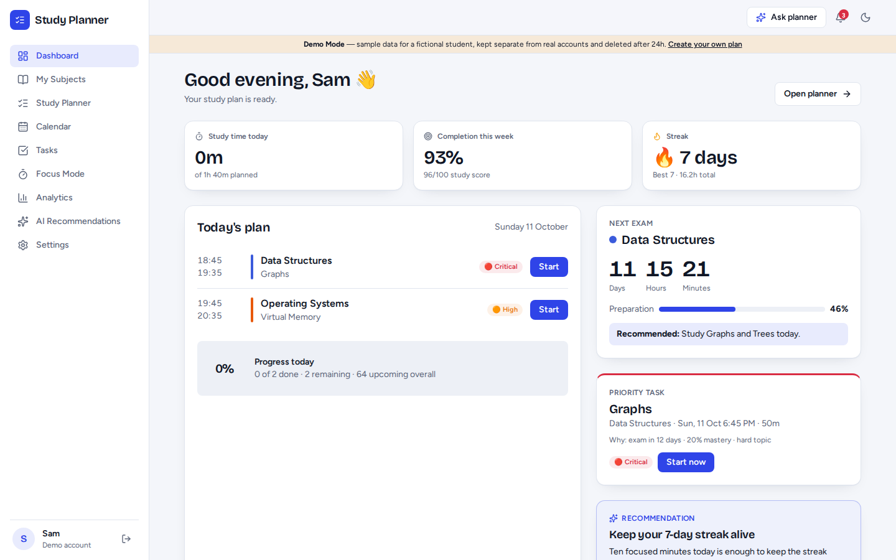
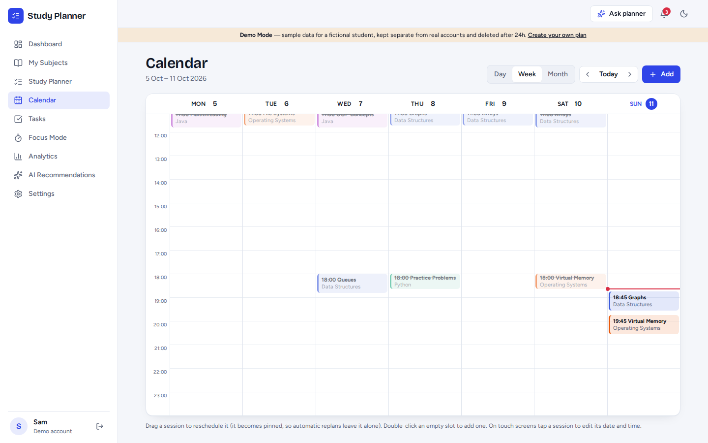
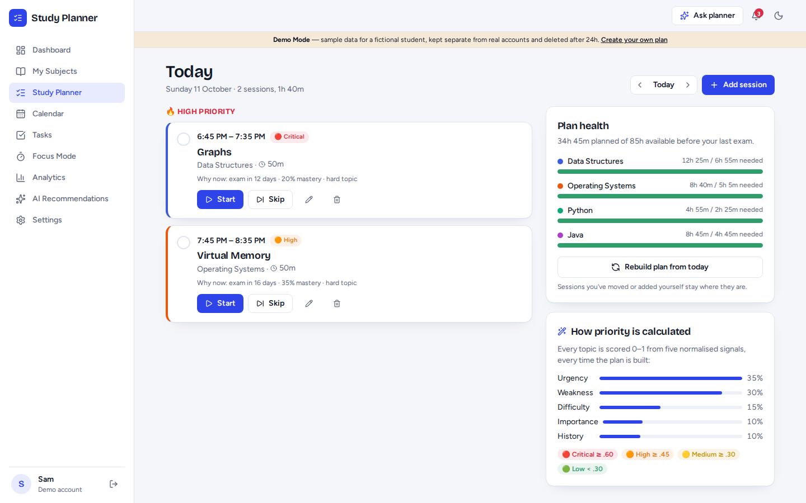
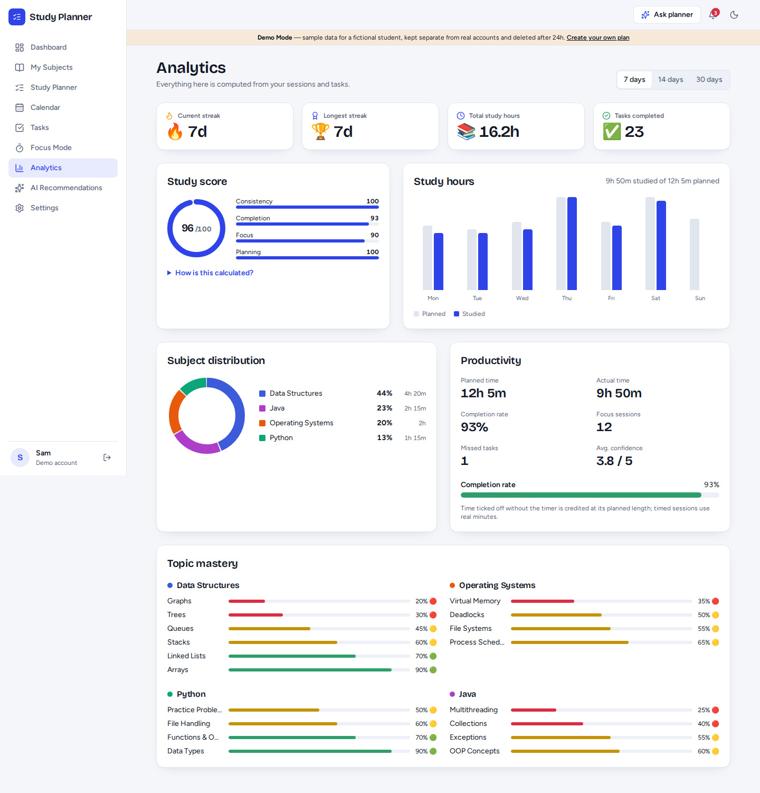
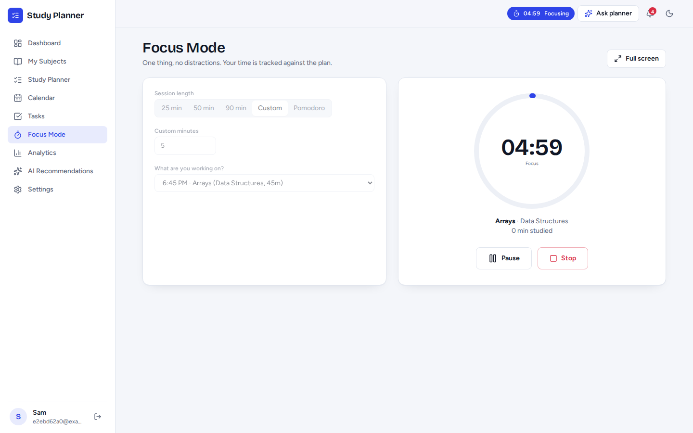
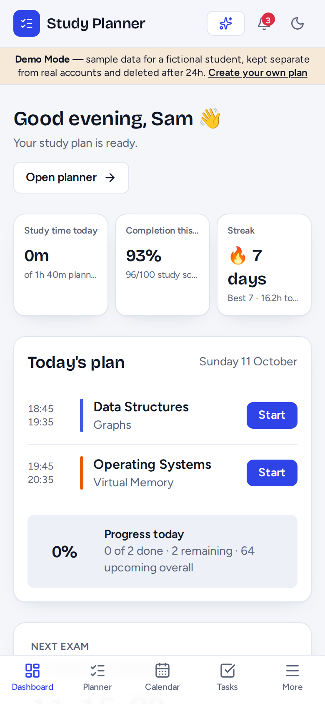

# AI Study Planner

An AI-assisted study planning web app for college students. You enter subjects, topics, exam dates and the hours you have; it builds a personalised schedule, tracks what you actually do, and **automatically rebuilds the plan when you miss or skip a session**.

> The scheduler is plain, inspectable algorithm code. AI is an optional layer for explanations and natural-language requests. If the AI is off or fails, everything still works.

| Dashboard | Calendar (week) |
|---|---|
|  |  |
| **Planner (today)** | **Analytics** |
|  |  |
| **Focus mode** | **Mobile** |
|  |  |

More in [`docs/screenshots`](docs/screenshots) (landing, onboarding, subjects, tasks, dark mode, assistant, mobile views).

## Features

- **Landing page + demo mode.** One click opens a sample student's plan. Each demo visitor gets their *own* throw-away `is_demo` user; demo rows are never shared with real accounts and are purged after 24 h.
- **Auth.** Register / login / logout, bcrypt-hashed passwords, JWT (HS256), per-user data isolation (every query is scoped by `user_id`).
- **8-step onboarding** (profile, subjects, topics, exam dates, hours, current level, target marks, preferred study times) → generates the plan.
- **Subjects page.** Add / edit / delete subjects and topics, per-topic mastery (🟢🟡🔴), difficulty, exam date. Every change replans.
- **Plan generator** with priority scoring, pacing, breaks, subject variation and pre-exam revision (below).
- **Auto-rescheduling.** Missed (overdue) or skipped sessions trigger a *recalculation* of the remaining plan, not a blind "shift to tomorrow". The moved topic is tagged "Moved from Mon".
- **Study balancer.** Hard daily cap, overload detection ("Your Wednesday plan contains 7.5 hours. Recommended maximum: 5 hours"), one-click rebalance.
- **Spaced revision.** Reviews after 1 / 3 / 7 / 14 (/ 30) days; low confidence → sooner, high confidence → longer, never on/after exam day.
- **Calendar.** Day / week / month, drag-and-drop rescheduling, double-click to add, edit duration, complete, skip, delete.
- **Planner (daily page).** Today's sessions grouped 🔥 High / Medium / Low with Start buttons, a "why now" reason on every session, plan health per subject.
- **Focus mode + Pomodoro.** 25 / 50 / 90 / custom, pause / resume / stop, survives page reloads, confidence rating on completion (😞 😐 🙂 😃 🤩), time logged against the task. Pomodoro 25/5/25/5/25/15 with custom settings.
- **Analytics.** Planned vs actual hours, completion rate, subject distribution, productivity, topic mastery, streaks, and a **documented study score**.
- **Recommendations.** Rule-based, always explained ("why am I seeing this?"), one-click apply. Optional "Explain with AI" and weekly strategy.
- **Planning assistant.** "I can't study tomorrow", "Study Trees tomorrow for 1 hour", "Move Python to Saturday", "Make my plan easier" → structured actions → preview → confirm → apply.
- **Notifications.** Upcoming session, missed task, exam approaching, daily plan, streak reminder (in-app, plus browser notifications when permitted and the app is open).
- **Dark mode**, responsive layouts (desktop → phone with bottom nav), loading skeletons, empty states, error states with retry.

## Architecture

```
React + Vite + TS + Tailwind  ──HTTPS/JSON──►  FastAPI  ──SQLAlchemy──►  SQLite (dev) / PostgreSQL (prod)
 (Vercel)   TanStack Query cache               (Render)        │
                                                               └─► AI provider (optional, cached, capped)
```

```
backend/app
├── main.py, config.py, database.py, models.py, schemas.py, security.py
├── routers/        auth · subjects · planner (+tasks, sessions) · insights (dashboard, analytics, recommendations, assistant, notifications)
└── services/
    ├── priority_service.py        topic priority + level + study-minutes estimate
    ├── planner_service.py         plan generation, allocator, overload/rebalance, missed-task sync
    ├── revision_service.py        spaced repetition + mastery updates
    ├── task_service.py            complete / skip / record session
    ├── streak_service.py          streaks
    ├── analytics_service.py       analytics + study score
    ├── recommendation_service.py  rule engine (+ optional AI explain/strategy)
    ├── assistant_service.py       NL parser, action whitelist, validation, executor
    ├── ai_service.py              provider client: cache, de-dup, quota, circuit breaker
    ├── notification_service.py    notification generation
    ├── dashboard_service.py       dashboard aggregation
    └── demo_service.py            isolated demo accounts + sample history
frontend/src
├── pages/       Landing · Auth · Onboarding · Dashboard · Subjects · Planner · Calendar · Tasks · Focus · Analytics · Recommendations · Settings
├── components/  Shell · ui (charts are hand-rolled SVG/CSS) · tasks · Assistant
└── lib/         api · auth · hooks · focus (global timer) · util · types
```

## Scheduling algorithm

**Priority** (`priority_service.py`), recomputed per topic *per day*, every term normalised to 0–1:

```
priority = 0.35·urgency + 0.30·weakness + 0.15·difficulty + 0.10·importance + 0.10·history
urgency    = exp(-days_to_exam / 14)                  (1.0 on exam day, ≈0.61 at 7 days, ≈0.12 at 30)
weakness   = 0.6·(1 - mastery) + 0.4·gap_to_target
difficulty = (topic difficulty - 1) / 4
importance = 0.7·(subject importance - 1)/4 + 0.3·target_marks
history    = min(1, 0.25·missed_sessions + 0.3 if not studied in 7 days)
levels:  ≥0.60 🔴 critical · ≥0.45 🟠 high · ≥0.30 🟡 medium · else 🟢 low
```

**Plan generation** (`planner_service.generate`) rebuilds all unlocked, pending, generated tasks from now on:

1. Needed minutes per topic from mastery gap, difficulty and target marks, minus time already booked by fixed tasks.
2. Pre-exam revision slots reserved on the last days before each exam (3 / 2 / 1 per topic for mastery <40 / <65 / ≥65).
3. Day by day: capacity = weekday hours (or one-off override), capped by the max-daily setting, minus fixed tasks. A **pacing target** spreads work (remaining need ÷ remaining capacity × 1.6) but never drops below what each exam needs per remaining day.
4. Blocks are chosen by `priority(day) × deadline pressure`, penalised for repeating the same subject/topic (variation), and placed into free slots inside the preferred windows (morning 08–12, afternoon 13:30–17, evening 18–21:30, night 21:30–23:30) with breaks between blocks, a soft per-window cap so work spreads across the day, and a break after ~100 min of back-to-back study.
5. Shortfalls and capacity problems are returned as warnings ("You need ~14h of study but only have ~11h available").

**Auto-rescheduling.** `sync()` marks pending sessions whose end time (+15 min grace) has passed as *overdue*, bumps the topic's miss count (raising its priority), then runs `generate()` again. Because needs are recomputed from remaining need, remaining days and capacity, the missed topic reappears at the best slot, and the new session is tagged with where it was moved from. Sessions you moved or added yourself are `locked` and survive replans.

**Study score** (0–100, trailing 7 days, no randomness): `0.30·consistency + 0.30·completion + 0.20·focus + 0.20·planning`. Definitions are in `analytics_service.py` and in the app (Analytics → "How is this calculated?").

## AI strategy and cost control

| Layer | Uses AI? |
|---|---|
| Dates, times, priority, scheduling, completion, streaks, analytics, score, overdue detection, notifications, calendar, rebalancing, **rule-based recommendations with reasons** | **Never** |
| Common assistant phrases ("I can't study tomorrow", "Study Trees tomorrow for 1 hour"…) | No: parsed locally |
| Unrecognised assistant text, "Explain with AI", weekly strategy | Optional, small prompt (≤ ~450 output tokens) |

Controls in `ai_service.py`: DB response cache (24 h, keyed by hash of model + prompt), per-key lock so identical concurrent requests make one call, per-user daily cap (`AI_DAILY_LIMIT_PER_USER`, default 25), circuit breaker after 3 consecutive failures, 20 s timeout. On any failure the API returns "AI recommendations are temporarily unavailable. Your normal study planner is still working." and the planner carries on.

**The model never writes to the database.** It can only propose actions from a whitelist (`add_task`, `move_task`, `block_day`, `set_daily_limit`, `focus_subject`, `add_revision`, `replan`). Each is validated with Pydantic and name-resolved against your own subjects, previewed to you, re-validated on apply, and executed by ordinary planner code. Unknown actions are rejected (422).

## Database

`users` · `study_preferences` · `subjects` · `exams` · `topics` · `study_tasks` · `study_sessions` · `progress` (daily rollup) · `ai_recommendations` · `notifications` · plus `ai_cache` and `ai_usage` for the AI layer. Foreign keys cascade on delete; indexes on `(user_id, date)`, `(user_id, status)`, `topic_id`, `subject_id`, session and progress dates; unique constraints on `(user_id, email/subject name/day/dedupe_key)`.
Dates are the user's *local* calendar dates; clock times are minutes from midnight; each user has a timezone (detected from the browser).

## API (42 endpoints, prefix `/api` unless noted)

```
GET /health
Auth      POST auth/register · auth/login · auth/logout · GET auth/me · POST demo/start · DELETE account
Setup     POST onboarding · GET/PUT settings
Subjects  GET/POST subjects · PUT/DELETE subjects/{id} · POST subjects/{id}/topics · PUT/DELETE topics/{id}
Planner   POST planner/generate · planner/sync · planner/rebalance · GET planner/overview
Tasks     GET/POST tasks · PUT/DELETE tasks/{id} · POST tasks/{id}/start|complete|skip · POST sessions
Insights  GET dashboard · GET analytics?days= · GET ai/status
Recs      GET recommendations · POST recommendations/{id}/apply|dismiss|explain · POST recommendations/strategy
Assistant POST assistant/interpret · assistant/apply
Notifs    GET notifications · POST notifications/{id}/read · notifications/read-all
```
Interactive docs at `/docs` in development (disabled when `ENVIRONMENT=production`).

## Local setup

Requirements: Python 3.12, Node 20+.

```bash
# backend (http://localhost:8000)
cd backend
python -m venv venv && source venv/bin/activate        # Windows: venv\Scripts\activate
pip install -r requirements-dev.txt
cp .env.example .env                                   # defaults work for local dev (SQLite)
uvicorn app.main:app --reload

# frontend (http://localhost:5173), in another terminal
cd frontend
npm install
npm run dev                                            # Vite proxies /api to :8000
```
Open http://localhost:5173 and click **Try the demo**, or register.

Tests: `cd backend && pytest -q` (32 tests). Browser end-to-end (needs `pip install playwright && playwright install chromium`, `npm run build` with `VITE_API_URL=http://127.0.0.1:8000`): `scripts/e2e.sh`.

## Environment variables

Backend (`backend/.env.example`):

| Name | Purpose |
|---|---|
| `DATABASE_URL` | `sqlite:///./study_planner.db` locally; PostgreSQL URL in production (`postgres://` and `postgresql://` are accepted) |
| `SECRET_KEY` | JWT signing key. **Required** (≥ 32 chars) when `ENVIRONMENT=production`; the app refuses to start otherwise |
| `CORS_ORIGINS` | Comma-separated allowed frontend origins |
| `ENVIRONMENT` | `development` or `production` |
| `AI_API_KEY`, `AI_MODEL` | Optional. Leave `AI_API_KEY` empty to run without AI. `AI_PROVIDER=anthropic` (default) or `openai` (+ `AI_BASE_URL`) |
| `AI_DAILY_LIMIT_PER_USER` | Hard cap on AI calls per user per day |

Frontend (`frontend/.env.example`): `VITE_API_URL`, the backend's public URL (empty in local dev).
Secrets live only in environment variables; `.env` is git-ignored.

## GitHub

```bash
cd ai-study-planner
git init && git add . && git commit -m "AI Study Planner"
git branch -M main
git remote add origin https://github.com/<you>/ai-study-planner.git
git push -u origin main
```
`.gitignore` already excludes `.env`, `node_modules`, `venv`, `__pycache__`, `dist` and `*.db`. A CI workflow (`.github/workflows/ci.yml`) runs the backend tests and the frontend build.

## Deployment (Vercel + Render + PostgreSQL)

**1. Backend + database on Render.** *New → Blueprint* → pick your repo. `render.yaml` creates the API service and a PostgreSQL database and wires `DATABASE_URL`, a generated `SECRET_KEY`, and the start command. When prompted set `CORS_ORIGINS` (your Vercel URL, filled in after step 2; you can edit it later) and optionally `AI_API_KEY`. Check `https://<api>.onrender.com/health`.
**2. Frontend on Vercel.** *Add New Project* → import the repo → set **Root Directory = `frontend`** (framework auto-detected as Vite) → add env var `VITE_API_URL=https://<api>.onrender.com` → Deploy. `vercel.json` handles SPA routing and asset caching.
**3.** Put the Vercel URL into Render's `CORS_ORIGINS` (no trailing slash) and redeploy the API.

Free tiers sleep when idle (the first request can take ~30 s) and have database limits. Check each provider's current terms. Tables are created on startup (`create_all`).

## Testing

- **Backend: 32 tests** (pytest): auth & hashing, user isolation, request-size limit, priority maths, plan invariants (never past an exam, within capacity, breaks, variation, weak topics get more time), overload + rebalance, completion → mastery + spaced review, review intervals, skip → reschedule, missed-session detection + idempotent replan, task CRUD/overlap/validation, manual tasks survive replans, assistant actions (rules, AI output validation, whitelist rejection), AI off / failing / cached / capped, streaks, analytics & score, subjects/settings, dashboard, notifications, demo isolation, onboarding validation.
- **Browser: 33 Playwright checks** against a production build + gunicorn: landing, register, 8-step onboarding, every page, complete/skip, focus timer, assistant, calendar drag-and-drop, dark mode persistence, logout/login, guarded routes, demo mode, mobile layout and per-page horizontal-overflow checks. No console errors.

## Known limitations

- Not exercised against a live PostgreSQL server in the build environment (SQLite was; the models and URL handling are Postgres-ready). Run the Render deploy once and smoke-test.
- The live AI path was not called against a real provider (no key available). It is covered with mocked tests (validation, caching, caps, failure fallback).
- Schema is created with `create_all`; there are no migrations (Alembic is the next step).
- JWT is stateless: logout discards the token client-side; the token lives in `localStorage`. No email verification or password reset.
- The rate limiter and AI circuit breaker are in-memory per process.
- Drag-and-drop uses HTML5 DnD (desktop). On touch devices, tap a session to edit its date/time.
- Notifications fire only while the app is open (no service worker / push).
- Mastery changes after a session are a simple heuristic (documented in `revision_service.py`), not a learning model.
- The planner assumes one study block per slot and fixed windows; fixed commitments (classes) are not modelled yet. Block them with "days you can't study" or manual sessions.

## Future improvements

Alembic migrations · class timetable import · push notifications / PWA · Google Calendar sync · richer spaced-repetition (per-topic ease) · teacher/shared plans · password reset & OAuth.
